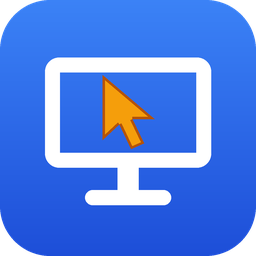

<p align="center">
  
</p>

<h1 align="center">KodDesk</h1>

<p align="center">
  Fast, sharp and private remote desktop for Windows.<br>
  <a href="https://kod47.github.io/kod-desk/"><b>Website</b></a> ·
  <a href="../../releases/latest"><b>Download</b></a>
</p>

---

KodDesk lets you see and control another Windows computer from anywhere — at home, at work or on the road —
with a crisp picture, low latency and no subscription.

## Features

- **Crisp picture** — full-color video (4:4:4 on NVIDIA GPUs) with correct colors: text and images look like
  on the original screen, not washed out.
- **Low latency** — hardware video encoding (NVIDIA, Intel, AMD) and automatic adaptation to the network speed.
- **Works anywhere** — no port forwarding or router configuration needed; both computers simply connect over the internet.
- **End-to-end encrypted** — the session is encrypted between the two computers; nobody in between can see
  your screen, keystrokes or password.
- **Unattended access** — runs as a Windows service: reach your computer after a restart, at the sign-in screen,
  through UAC prompts, and send Ctrl+Alt+Del.
- **File transfer** — drag & drop files onto the remote screen, or browse the remote computer's files and
  download/upload with a click.
- **Shared clipboard** — copy text, images and even files on one computer and paste them on the other (Ctrl+C / Ctrl+V).
- **Multi-monitor** — switch between the remote computer's screens.
- **Remembered passwords** — connect to your computers with one click.

## Download

🌐 **Website:** [kod47.github.io/kod-desk](https://kod47.github.io/kod-desk/)

Get the latest installer from the website or from the [Releases](../../releases/latest) page: `KodDesk-<version>-x64.msi`.

**Requirements:** Windows 10 or 11 (64-bit). A graphics card with hardware video encoding is recommended
(KodDesk falls back to software encoding otherwise).

> The user interface is currently in Romanian; the labels below are given as they appear in the app, with a translation.

## Getting started

1. Install KodDesk on both computers (administrator rights are required for the background service).
2. On the computer you want to reach, open **KodDesk** and set an access password:
   **Setări serviciu (parolă)** (*Service settings (password)*).
3. Note its 9-digit **ID** shown in the main window.
4. On the other computer, enter that ID and the password, then click **Conectare** (*Connect*).

Tips:

- Tick **Memorează parola** (*Remember password*) to reconnect next time without typing it.
- Use the **Fișiere** (*Files*) menu in the session window to send files or open the remote file explorer.
- Copy and paste works in both directions; it can be turned off from the **Fișiere** menu.
- To update, simply install a newer version over the existing one — your ID and password are kept.

## Privacy & security

- Sessions are end-to-end encrypted and authenticated with the access password.
- The password itself is never sent over the network and is never stored in plain text.
- On the controlled computer, files are read and written with the permissions of the signed-in user.
- Without the access password, nobody can connect to your computer.

## Building from source

Requires the .NET 10 SDK on Windows:

```powershell
./tools/get-ffmpeg.ps1      # one-time: downloads the FFmpeg libraries
dotnet build KodDesk.slnx
```

## Third-party components

KodDesk uses [FFmpeg](https://ffmpeg.org) for video encoding and decoding, and
[Vortice.Windows](https://github.com/amerkoleci/Vortice.Windows) for screen capture.

## Support the project

KodDesk is free. If you find it useful and would like to support its development, you can make a donation
via PayPal to **kod447@gmail.com**. Thank you!

## License

KodDesk is free software, licensed under the [GNU General Public License v3.0](LICENSE).
See [THIRD-PARTY-NOTICES.md](THIRD-PARTY-NOTICES.md) for the licenses of the included components.
